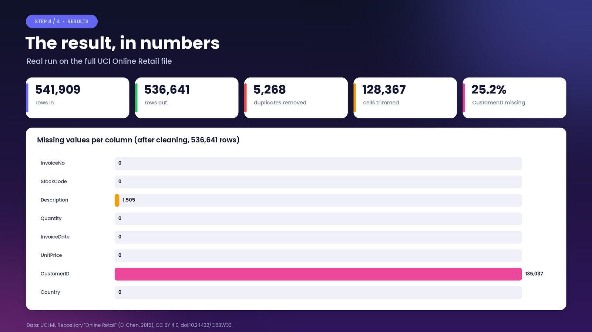
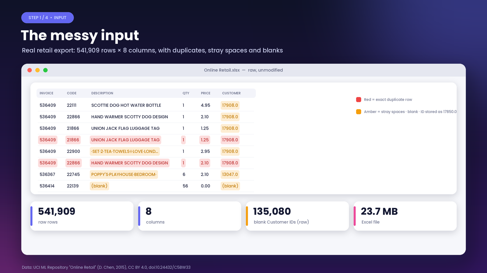
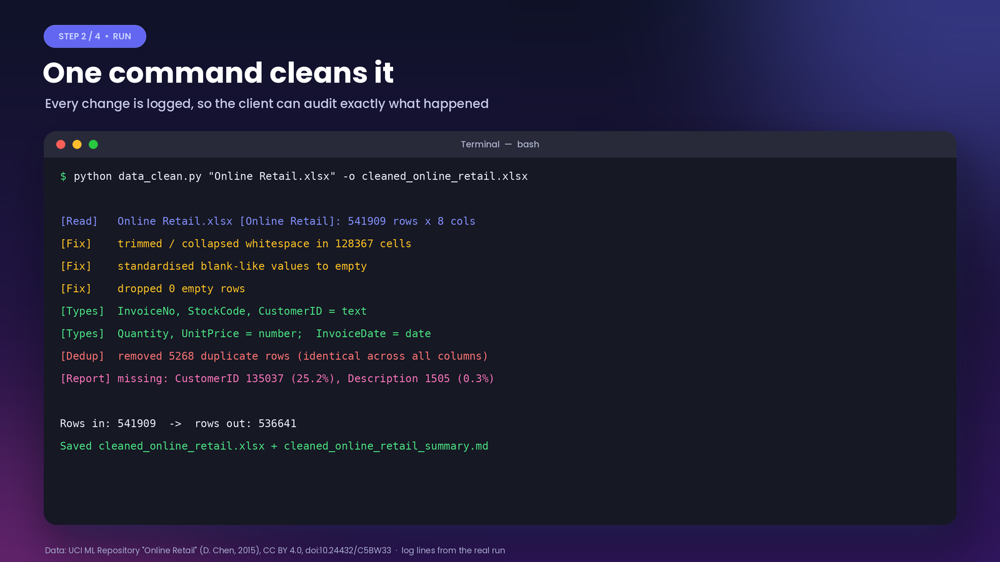
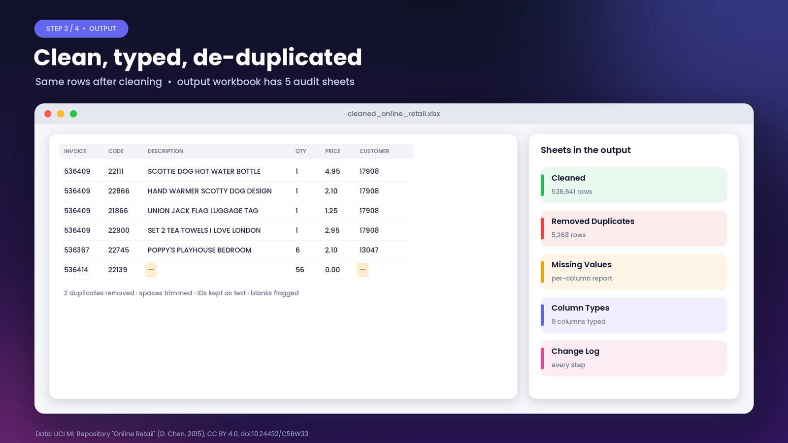

# Python Data Cleaner

Turns messy Excel/CSV exports into a clean, typed, de-duplicated workbook, with a full audit trail of every change.



## Problem
Business exports are rarely analysis-ready: duplicate rows, stray and double spaces, IDs saved as numbers (`17850.0`), blank-like values (`N/A`, `-`, `null`), and dates or numbers stored as text. Fixing this by hand in Excel is slow and nobody can check what was changed.

## Solution
`data_clean.py` is one command that:
1. Reads any mix of `.csv .tsv .txt .xlsx .xls` files or folders (auto-detects delimiter and encoding, reads every sheet)
2. Normalises headers and matches them across files
3. Trims and collapses whitespace, and turns blank-like values into real blanks
4. Drops fully empty rows and columns
5. Detects numeric and date columns and converts them (handles `$`, commas, `%`, `(negatives)`, mixed date formats)
6. Removes exact duplicates, or duplicates on `--key` columns
7. Writes a missing-values report, a column-types sheet and a change log, plus a plain-English `_summary.md`

## Results (real run)
Run on the full, unmodified **UCI Online Retail** dataset (541,909 rows × 8 columns):

| Metric | Value |
|---|---|
| Rows in → rows out | 541,909 → **536,641** |
| Exact duplicate rows removed | **5,268** |
| Cells with extra spaces fixed | **128,367** |
| Columns typed | 8 (`InvoiceNo`, `StockCode`, `CustomerID` kept as text, `Quantity`/`UnitPrice` numbers, `InvoiceDate` date) |
| Missing values flagged | `CustomerID` 135,037 (25.2%), `Description` 1,505 (0.3%) |

Output workbook sheets: **Cleaned**, **Removed Duplicates**, **Missing Values**, **Column Types**, **Change Log**.

## Quick start
```bash
pip install -r requirements.txt
python scripts/download_data.py                       # optional: fetch the demo dataset into data/
python data_clean.py "data/Online Retail.xlsx" -o cleaned_online_retail.xlsx
```
Options: `--key COL [COL ...]` (dedupe on key columns), `--dayfirst`, `--no-merge`, `--fill-numeric {none,zero,median}`. Run `python data_clean.py -h` for details.

## Screenshots
| | |
|---|---|
|  |  |
|  |  |

## Data source & licence
- Demo data: Chen, D. (2015). *Online Retail* [Dataset]. UCI Machine Learning Repository. https://doi.org/10.24432/C5BW33, licensed **CC BY 4.0**. The dataset is not committed to this repo; `scripts/download_data.py` fetches it.
- Code: MIT licence, see [LICENSE](LICENSE).
